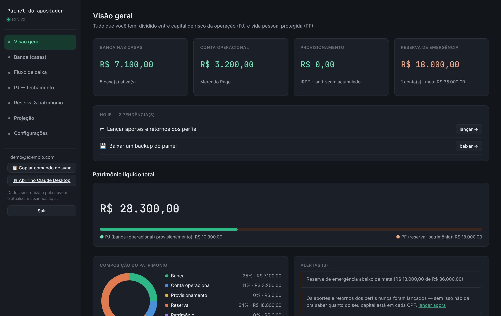

# Portfólio — Pedro

Projetos de desenvolvimento web e automação que construí durante a faculdade
e por conta própria. Cada seção explica o problema, o que o projeto faz e as
tecnologias usadas.

| Projeto | Stack principal | Demo |
|---|---|---|
| [Painel financeiro pessoal](#painel-financeiro-pessoal) | HTML/CSS/JS, Supabase (Postgres + Auth + Realtime), GitHub Actions | [GitHub Pages](https://pedrople10.github.io/Academico/) |
| [Sistema Acadêmico (ASP.NET Core MVC)](#sistema-acadêmico-aspnet-core-mvc) | C#, .NET 8, Entity Framework Core, SQL Server | rodar localmente |

---

## Painel financeiro pessoal

📂 [`apostas/painel/`](apostas/painel/) · 🔗 [Demo](https://pedrople10.github.io/Academico/) (é preciso criar uma conta na tela inicial)


<sub>Print com dados fictícios.</sub>

Aplicação web de página única para acompanhar saldos espalhados em várias
contas e plataformas sem depender de planilha. Responde, em uma tela, quanto
dinheiro existe em cada conta, quanto pode ser sacado, quanto é lucro de
verdade e quanto precisa ser separado para o imposto.

**Funcionalidades**

- **Saldos por conta**, com meta de quanto manter em cada uma e a ação
  sugerida (sacar ou depositar), ordenadas pelo valor da pendência.
- **Resultado real**: variação de saldo descontando depósitos e somando
  saques, para que um aporte não apareça como lucro.
- **Fechamento mensal** com lucro, provisão de IR e retirada sugerida.
- **Estimativa de IRPF por CPF**, aplicando a alíquota apenas sobre o
  excedente da faixa de isenção de cada pessoa.
- **Orçamento pessoal** separando custo fixo de gasto variável, que define a
  meta da reserva de emergência.
- **Projeção de patrimônio** em 6, 12, 24 e 36 meses, ligando e desligando
  fontes de receita para comparar cenários.
- **Importação de planilhas** (.xlsx) e **backup** completo em arquivo.
- Layout responsivo, com menu lateral em gaveta no celular.

**Tecnologias e decisões técnicas**

- **Front-end sem framework**: HTML, CSS e JavaScript puro em um único
  arquivo, com tema escuro baseado em variáveis CSS.
- **Supabase** como back-end: autenticação por e-mail e senha, banco
  Postgres e **Realtime** (o painel atualiza sozinho quando outro processo
  grava novos dados).
- **Row Level Security** no Postgres ([`schema.sql`](apostas/painel/schema.sql)):
  cada usuário só lê e grava a própria linha, então a chave pública do
  front-end não dá acesso aos dados de outras pessoas.
- **Deploy contínuo** com GitHub Actions
  ([`deploy-painel.yml`](.github/workflows/deploy-painel.yml)): todo push
  que altera o painel publica a nova versão no GitHub Pages.
- **Scripts de apoio em Python** ([`apostas/automacao/`](apostas/automacao/))
  que leem saldos pelo Chrome DevTools Protocol e enviam ao Supabase pela
  API REST, com interface gráfica em Tkinter.

---

## Sistema Acadêmico (ASP.NET Core MVC)

📂 raiz do repositório ([`Controllers/`](Controllers/), [`Models/`](Models/), [`Views/`](Views/))

Sistema web de cadastro acadêmico feito na disciplina de desenvolvimento
web, seguindo o padrão MVC.

**Funcionalidades**

- CRUD completo (listar, detalhar, criar, editar e excluir) de
  **Instituições**, **Departamentos**, **Cursos** e **Alunos**.
- Relacionamentos entre entidades: uma instituição tem departamentos, e
  cada departamento tem cursos.
- Banco populado automaticamente com dados de exemplo na primeira execução.

**Tecnologias**

- C# com **ASP.NET Core MVC** (.NET 8) e views Razor
- **Entity Framework Core 8** com migrations
- **SQL Server LocalDB**
- Bootstrap e validação no cliente com jQuery Validation

**Como rodar**

```bash
dotnet restore
dotnet ef database update
dotnet run
```

Requer o .NET 8 SDK e o SQL Server LocalDB (instalado com o Visual Studio).
A string de conexão fica em `appsettings.json`.

---

## Contato

GitHub: [@pedrople10](https://github.com/pedrople10)
